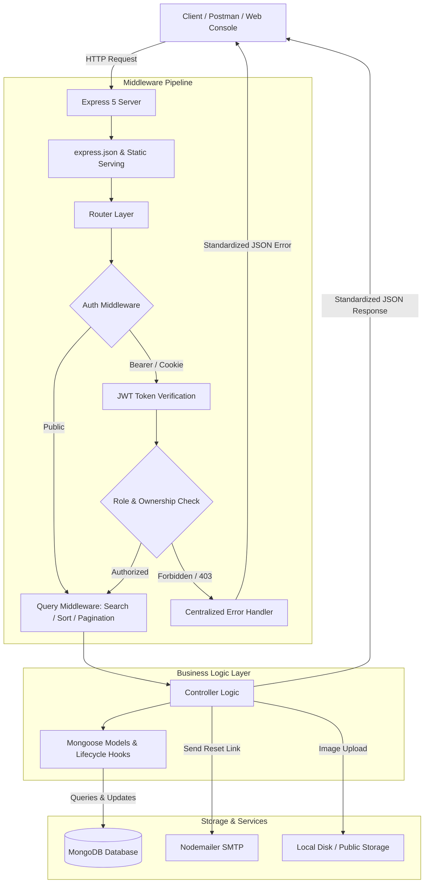

# Question Answer REST API

A production-grade, enterprise-ready **Question & Answer RESTful API** engineered with **Node.js**, **Express 5**, and **MongoDB / Mongoose**. Designed with a clean layered architecture, featuring JWT authentication with HTTP-only cookies, granular Role-Based Access Control (RBAC), advanced reusable query middleware (regex search, dynamic sorting, pagination), automated password reset via SMTP, file uploads, and an interactive built-in **API Console**.

[](https://nodejs.org/)
[](https://expressjs.com/)
[](https://www.mongodb.com/)
[](https://mongoosejs.com/)
[](https://jwt.io/)
[](https://www.postman.com/)
[](LICENSE)

---

## Table of Contents

- [Overview & Architecture](#overview--architecture)
- [System Architecture](#system-architecture)
- [Key Features](#key-features)
- [Tech Stack](#tech-stack)
- [Project Directory Structure](#project-directory-structure)
- [API Reference](#api-reference)
  - [Root & Health Check](#root--health-check)
  - [Authentication & User Profile](#authentication--user-profile)
  - [Questions](#questions)
  - [Answers](#answers)
  - [Users](#users)
  - [Admin](#admin)
- [Postman Collection & Quickstart](#postman-collection--quickstart)
- [Database Seeding & Test Accounts](#database-seeding--test-accounts)
- [Environment Variables](#environment-variables)
- [Getting Started](#getting-started)
- [Security & Best Practices](#security--best-practices)
- [Author & License](#author--license)

---

## Overview & Architecture

This repository is built as a backend portfolio showcase demonstrating clean architecture, defensive programming, and RESTful best practices.

Rather than bundling a heavy front-end framework, this service serves a lightweight, zero-dependency **Interactive Web API Console** on `http://localhost:5001/` to let reviewers, developers, and hiring managers test real endpoints in the browser without requiring external clients.

### Architectural Highlights

- **Separation of Concerns:** Strict decoupling between routing (`routers/`), business logic (`controllers/`), data schemas & hooks (`models/`), and cross-cutting concerns (`middlewares/`).
- **Dry Query Engine:** Instead of duplicating pagination, sorting, and text search across controllers, reusable higher-order query middlewares process and attach pagination metadata to responses.
- **Defensive Error Handling:** An asynchronous error wrapper catches unhandled rejections, while a centralized error middleware transforms MongoDB duplicate keys, validation errors, and invalid ObjectIDs into standardized HTTP status codes.

---

## System Architecture



---

## Key Features

- **Robust Authentication & JWT:**
  - Secure password hashing with `bcryptjs` (salt work factor of 10).
  - Stateless JSON Web Tokens (JWT) with configurable expiration (`JWT_EXPIRE`).
  - Dual delivery: JWT delivered in the JSON body (`acces_token`) and secure `httpOnly` cookie.
- **Granular Authorization & RBAC:**
  - **Public:** Browse questions, view public user profiles, search, register, login.
  - **Authenticated User:** Ask questions, post answers, like / unlike questions & answers, upload avatar image.
  - **Resource Owner:** Edit or delete questions and answers authored by oneself.
  - **Administrator:** Block / unblock users and delete accounts.
- **Advanced Query Engine:**
  - **Regex Full-text Search:** `?search=<keyword>` filters questions by title/content and users by name.
  - **Dynamic Sorting:** `?sortBy=most-liked`, `?sortBy=most-answered`, or creation date.
  - **Pagination:** `?page=1&limit=5` with automated calculation of `previous` and `next` page links.
- **Lifecycle Hooks & Cascading Deletions:**
  - Auto-generation of URL-friendly slugs using `slugify` before saving questions.
  - Cascading deletion: deleting a question automatically removes all its associated answers from the database.
- **File Uploads (Multer):**
  - Profile image uploads with MIME-type filtering (`image/jpeg`, `image/png`, `image/jpg`, `image/gif`) and file size limits.
- **Password Reset Flow:**
  - Cryptographically secure reset token generation using Node's native `crypto` module.
  - SHA-256 hashed token stored with expiration (`RESET_PASSWORD_EXPIRE`).
  - Automated transactional email delivery via `nodemailer` SMTP.
- **Built-in Web API Console:**
  - Interactive UI located at `/` to inspect endpoints, submit requests, and inspect JSON responses with zero external dependencies.

---

## Tech Stack

| Component | Technology | Description |
|---|---|---|
| **Runtime** | [Node.js](https://nodejs.org/) (v18+) | Asynchronous event-driven JavaScript runtime |
| **Framework** | [Express 5](https://expressjs.com/) | Fast, unopinionated, minimalist web framework |
| **Database** | [MongoDB](https://www.mongodb.com/) | NoSQL document-based database |
| **ODM** | [Mongoose](https://mongoosejs.com/) (v9) | Schema validation, lifecycle hooks, and population |
| **Authentication** | [jsonwebtoken](https://github.com/auth0/node-jsonwebtoken) | JWT creation and verification |
| **Password Hashing**| [bcryptjs](https://github.com/dcodeIO/bcrypt.js) | Blowfish-based password hashing |
| **File Handling** | [Multer](https://github.com/expressjs/multer) | Multipart/form-data handler for file uploads |
| **Email Service** | [Nodemailer](https://nodemailer.com/) | SMTP transactional email client |
| **Environment** | [dotenv](https://github.com/motdotla/dotenv) | Environment variable management |
| **Slug Generator** | [slugify](https://github.com/simov/slugify) | URL slug creation for SEO-friendly question titles |

---

## Project Directory Structure

```text
question-answer-restApi/
├── config/
│   └── env/
│       ├── config.env.example       # Template for environment configuration
│       └── config.env               # (Git-ignored) Local secrets & database URI
├── controllers/
│   ├── admin.js                     # Admin actions: block, delete users
│   ├── answer.js                    # Answer CRUD and like operations
│   ├── auth.js                      # Register, login, profile, reset password
│   ├── question.js                  # Question CRUD and like operations
│   └── user.js                      # User profile listing and retrieval
├── dummy/
│   ├── answers.json                 # Seed answers
│   ├── questions.json               # Seed questions
│   └── users.json                   # Seed users (including admin account)
├── helpers/
│   ├── authorization/               # JWT cookie and header utilities
│   ├── database/                    # MongoDB connection helper
│   ├── error/                       # CustomError subclass
│   ├── input/                       # Input validation & bcrypt comparison
│   └── libraries/                   # Nodemailer email sender
├── middlewares/
│   ├── authorization/               # Route access, owner access, admin access
│   ├── database/                    # Entity existence verifiers (404 checks)
│   ├── errors/                      # Centralized Express error handler
│   ├── libraries/                   # Multer profile image upload handler
│   └── query/                       # Reusable pagination, search & sort logic
├── models/
│   ├── Answer.js                    # Answer schema and hooks
│   ├── Questions.js                 # Question schema, slugify, cascading delete
│   └── user.js                      # User schema, password hash, JWT generation
├── postman/
│   ├── Question-Answer-Api.postman_collection.json   # Full Postman API collection
│   └── Question-Answer-Api.postman_environment.json  # Postman environment config
├── public/
│   ├── css/                         # API Console stylesheets
│   ├── js/                          # API Console client logic
│   ├── uploads/                     # Uploaded profile images
│   └── index.html                   # Built-in Web API Console interface
├── routers/
│   ├── admin.js                     # Admin route definitions
│   ├── answer.js                    # Answer route definitions
│   ├── auth.js                      # Auth route definitions
│   ├── index.js                     # Master router entry point
│   ├── question.js                  # Question route definitions
│   └── user.js                      # User route definitions
├── dummy-generator.js               # CLI script for seeding and wiping dummy data
├── package.json                     # Project manifest and scripts
├── server.js                        # Application entry point and server bootstrap
└── README.md                        # Documentation
```

---

## API Reference

Base URL: `http://localhost:5001/api`

### Root & Health Check

| Method | Endpoint | Access | Description |
|---|---|---|---|
| `GET` | `/api` | Public | Returns API status, version, and catalog of resources |

---

### Authentication & User Profile

| Method | Endpoint | Access | Request Body / Parameters | Description |
|---|---|---|---|---|
| `POST` | `/api/auth/register` | Public | `{ name, email, password }` | Register a new user and receive JWT |
| `POST` | `/api/auth/login` | Public | `{ email, password }` | Login and receive JWT in body + cookie |
| `GET` | `/api/auth/profile` | Auth | Headers: `Bearer <token>` | Get the currently logged-in user profile |
| `GET` | `/api/auth/logout` | Auth | Headers: `Bearer <token>` | Clears auth cookie and invalidates session |
| `PUT` | `/api/auth/edit` | Auth | `{ name, title, place, about, website }` | Update user profile details |
| `POST` | `/api/auth/upload` | Auth | `multipart/form-data`: `profile_image` | Upload user profile picture |
| `POST` | `/api/auth/forgotpassword` | Public | `{ email }` | Sends password reset token to email |
| `PUT` | `/api/auth/resetpassword` | Public | Query: `?resetPasswordToken=...`, Body: `{ password }` | Reset password using email token |

---

### Questions

| Method | Endpoint | Access | Query / Body | Description |
|---|---|---|---|---|
| `GET` | `/api/questions` | Public | `?search=mongo&page=1&limit=5&sortBy=most-liked` | List all questions with pagination and search |
| `GET` | `/api/questions/:id` | Public | Param: `:id` | Get single question with populated answers |
| `POST` | `/api/questions/ask` | Auth | `{ title, content }` | Create a new question |
| `PUT` | `/api/questions/:id/edit`| Owner | `{ title, content }` | Edit question (restricted to author) |
| `DELETE`| `/api/questions/:id/delete`| Owner | Param: `:id` | Delete question and cascade delete answers |
| `GET` | `/api/questions/:id/like`| Auth | Param: `:id` | Like a question |
| `GET` | `/api/questions/:id/undo_like`| Auth | Param: `:id` | Undo like on a question |

---

### Answers

Answers are nested sub-resources under questions (`/api/questions/:question_id/answers`).

| Method | Endpoint | Access | Request Body / Param | Description |
|---|---|---|---|---|
| `GET` | `/api/questions/:question_id/answers` | Public | Param: `:question_id` | Get all answers for a specific question |
| `POST` | `/api/questions/:question_id/answers` | Auth | `{ content }` | Post an answer to a question |
| `GET` | `/api/questions/:question_id/answers/:answer_id` | Public | Param: `:question_id`, `:answer_id` | Get details of a single answer |
| `PUT` | `/api/questions/:question_id/answers/:answer_id/edit` | Owner | `{ content }` | Edit an answer (restricted to author) |
| `DELETE`| `/api/questions/:question_id/answers/:answer_id/delete`| Owner | Param: `:question_id`, `:answer_id` | Delete an answer (restricted to author) |
| `GET` | `/api/questions/:question_id/answers/:answer_id/like` | Auth | Param: `:question_id`, `:answer_id` | Like an answer |
| `GET` | `/api/questions/:question_id/answers/:answer_id/undoLike` | Auth | Param: `:question_id`, `:answer_id` | Undo like on an answer |

---

### Users

| Method | Endpoint | Access | Query / Param | Description |
|---|---|---|---|---|
| `GET` | `/api/users` | Public | `?search=emre&page=1&limit=5` | Get all users with search and pagination |
| `GET` | `/api/users/:id` | Public | Param: `:id` | Get public profile of a user by ID |

---

### Admin

| Method | Endpoint | Access | Description |
|---|---|---|---|
| `GET` | `/api/admin/block/:id` | Admin | Block or unblock a user account |
| `DELETE`| `/api/admin/user/:id` | Admin | Permanently delete a user account from database |

---

## Postman Collection & Quickstart

A fully configured Postman collection and environment are bundled in the [`postman/`](./postman/) directory for instant evaluation.

### How to Import & Use

1. Open **Postman**.
2. Click **Import** (top left).
3. Select the two files in the `postman/` directory:
   - `postman/Question-Answer-Api.postman_collection.json`
   - `postman/Question-Answer-Api.postman_environment.json`
4. In Postman, select the active environment: **Localhost Environment**.
5. **Automated Token Management:**
   - Execute the **Login User** or **Register User** request.
   - A built-in Postman Test Script automatically extracts `acces_token` and saves it to the environment and collection variables (`{{access_token}}`).
   - All subsequent authenticated requests automatically pass the valid Bearer token in headers without manual copy-pasting.

---

## Database Seeding & Test Accounts

You can populate the database with realistic sample data using the built-in CLI utility:

```bash
# Seed users, questions, and answers
npm run import

# Clear all data from the database
npm run delete
```

### Pre-Configured Test Accounts

| Account Role | Email | Password | Permissions |
|---|---|---|---|
| **Administrator** | `questionanswer.info@gmail.com` | `123456` | Full admin privileges (block/delete users, manage all content) |
| **User (Emre)** | `emretoker1212121212@gmail.com` | `123456` | Standard user (author of sample questions & answers) |
| **User (Mert)** | `mertugulcan12121212@gmail.com` | `123456` | Standard user |
| **User (Elif)** | `eliftoprak12121212@gmail.com` | `123456` | Standard user |
| **User (Özge)** | `ozgetasci12121212@gmail.com` | `123456` | Standard user |

---

## Environment Variables

Copy the provided example template to configure your local environment:

```bash
cp config/env/config.env.example config/env/config.env
```

| Variable | Type | Description | Example Value |
|---|---|---|---|
| `PORT` | Number | Port on which the Express server listens | `5001` |
| `NODE_ENV` | String | Environment mode (`development` / `production`) | `development` |
| `MONGO_URI` | String | MongoDB connection string (Local / Atlas) | `mongodb://127.0.0.1:27017/question-answer` |
| `JWT_SECRET_KEY` | String | Secret key used to sign JSON Web Tokens | `your_strong_jwt_secret` |
| `JWT_EXPIRE` | String | JWT token lifetime | `10m` |
| `JWT_COOKIE` | Number | Cookie expiration duration (in minutes) | `10` |
| `RESET_PASSWORD_EXPIRE` | Number | Password reset token expiration (in ms) | `3600000` (1 hour) |
| `SMTP_HOST` | String | SMTP email server host | `smtp.gmail.com` |
| `SMTP_PORT` | Number | SMTP email server port | `587` |
| `SMTP_USER` | String | SMTP account username / email | `your_email@gmail.com` |
| `SMTP_PASS` | String | SMTP application password | `your_smtp_app_password` |

---

## Getting Started

### Prerequisites

- [Node.js](https://nodejs.org/) (version 18.0.0 or higher recommended)
- [MongoDB](https://www.mongodb.com/) (local instance running or MongoDB Atlas connection URI)
- [Git](https://git-scm.com/)

### Installation & Run

1. **Clone the repository:**
   ```bash
   git clone https://github.com/your-username/question-answer-restApi.git
   cd question-answer-restApi
   ```

2. **Install dependencies:**
   ```bash
   npm install
   ```

3. **Configure environment variables:**
   ```bash
   cp config/env/config.env.example config/env/config.env
   # Open config/env/config.env and add your MONGO_URI and JWT_SECRET_KEY
   ```

4. **Seed sample data (optional but recommended):**
   ```bash
   npm run import
   ```

5. **Start development server:**
   ```bash
   npm run dev
   ```

6. **Explore the API:**
   - **Interactive Web Console:** Open [`http://localhost:5001`](http://localhost:5001) in your browser.
   - **API Root Endpoint:** Open [`http://localhost:5001/api`](http://localhost:5001/api).
   - **Postman:** Import the collection from [`postman/`](./postman/) and test endpoints.

---

## Security & Best Practices

- **Zero Secret Exposure:** `.env` and `config/env/config.env` are excluded by `.gitignore` to prevent secret leakage in version control.
- **Password Protection:** Passwords are never stored in plaintext and are salted & hashed using `bcryptjs`.
- **Query Protection:** Password fields use `select: false` in Mongoose schemas so credentials are never returned in public queries by accident.
- **Resource Ownership Validation:** Modifying or deleting a resource verifies that the authenticated user's ID matches the resource's `user` field before execution.
- **File Upload Restrictions:** Multer configuration restricts allowed extensions strictly to image MIME types to avoid malicious file execution.
- **HTTP-Only Cookies:** Tokens stored in cookies use `httpOnly: true` to prevent Cross-Site Scripting (XSS) token theft.

---

## Author & License

Developed with ❤️ by **Talha Öztürk**

- **GitHub:** [@TalhaOzturk](https://github.com/)
- **License:** Distributed under the [MIT License](LICENSE).
